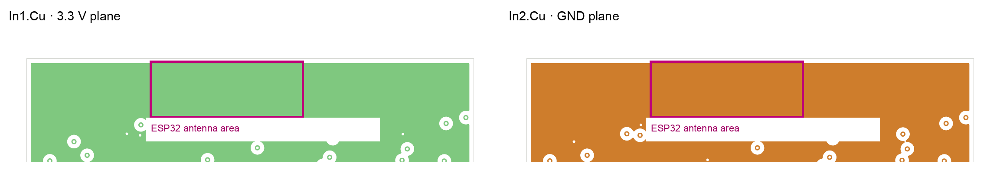

# Speaker PCB design review — 24 October 2026

## Scope and method

Reviewed the saved `Speaker.kicad_pcb` (15:20) and the newer `_autosave-Speaker.kicad_pcb` (15:30), together with all five schematic sheets, project rules, component libraries, and manufacturer guidance. The board files were not edited. Results refer to the saved board unless explicitly labelled **autosave**.

The review sequence was: KiCad 9.0.7 ERC and DRC with schematic parity; netlist and footprint inspection through KiCad's Python API; top and inner-layer plot inspection; conversion of the KiCad PCB with tscircuit's `kicad-to-circuit-json`; tscircuit shorts and PCB style checks; then component and use-case checks against manufacturer documents. These tools cannot establish real RF, thermal, or USB-source behavior without a prototype.

| Design inventory | Result |
| --- | --- |
| Board | 52.38 × 54.59 mm saved outline; 1.6 mm thick; 4 copper layers |
| Assembly | 92 footprints, all on the top side; 83 nets |
| Routing | 586 track segments; 132 through vias, 0.6/0.3 mm; 0.20 and 0.45 mm track widths |
| Planes | In1.Cu = 3.3 V; In2.Cu = GND |
| KiCad connectivity | 0 unrouted items; 0 schematic-to-board parity errors |

## Release assessment

**Do not release this revision for fabrication yet.** Two design issues can prevent intended RF and USB programming behavior. The USB power path, charger input bypass, regulator output capacitor, and battery temperature arrangement also need resolution or explicit design evidence. A clean autosave DRC would not address these issues.

## Findings, in repair order

### 1. Critical — copper planes beneath the ESP32 antenna

**Evidence:** U6's antenna region occupies approximately X 116.1–134.1 mm, Y 42.5–49.2 mm. The saved board top edge is Y 42.25 mm. The 3.3 V plane on In1.Cu and GND plane on In2.Cu both fill the antenna footprint; there is no copper keepout on either layer. The autosave retains these planes. The module's oversized courtyard does not act as a copper keepout. The plot below marks the area on both inner layers.

Espressif recommends the module antenna extend beyond the base board. If it cannot, its guidance calls for a clear antenna region without copper, routing, or components, and describes 15 mm clearance around the antenna area. This layout has substrate and two solid planes immediately underneath it. Expect detuning and reduced or unpredictable Wi-Fi/Bluetooth range. [Espressif ESP32 PCB layout guide](https://docs.espressif.com/projects/esp-hardware-design-guidelines/en/latest/esp32/pcb-layout-design.html)

**Fix:** Move U6 so the antenna projects beyond the board edge, or redesign the board shape and clear **all copper layers** in the required region. Add KiCad keepouts that block tracks, vias, and zones, then inspect the re-filled Gerbers. Validate RF throughput and range with the intended enclosure.

### 2. Critical — USB serial circuit will not reliably enter the ESP32 bootloader

**Evidence:** CH340X U5 pin 4 (`RTS#`) reaches ESP32 U6 GPIO0 through C12 (100 nF). U5 pin 6 (`TNOW/DTR#`) reaches U6 EN through C13 (100 nF). This reverses the `RTS → EN`, `DTR → GPIO0` mapping specified by Espressif's esptool documentation. Series capacitors only convey transitions; they do not hold GPIO0 at a chosen boot level during reset. WCH says CH340X pin 6 defaults to `TNOW` until an external resistor selects DTR mode; this board has no such resistor. SW1 pulls EN low but there is no dedicated GPIO0/BOOT button. C11, the EN-to-GND capacitor, is 100 nF. [Espressif boot mode guide](https://docs.espressif.com/projects/esptool/en/latest/esp32/advanced-topics/boot-mode-selection.html), [WCH CH340X datasheet, section 5.3](https://www.wch-ic.com/downloads/CH340DS1_PDF.html)

**Consequence:** USB UART may enumerate and pass serial data, while automatic firmware flashing fails. Manual boot entry also lacks a convenient control.

**Fix:** Remove series C12/C13; implement the [Espressif DevKitC two-transistor auto-reset circuit](https://dl.espressif.com/dl/schematics/esp32_devkitc_v4-sch-20180607a.pdf) with U5 `RTS#` controlling U6 EN and U5 `DTR#` controlling U6 GPIO0. Add 4.7 kΩ **between U5 pins 6 and 5** to select the CH340X push-pull DTR mode recommended by [WCH for ESP32](https://www.wch.cn/application/575.html); the pin-6-to-GND option selects a different, default-low output mode. Retain R16 = 10 kΩ from EN to 3.3 V, and change C11 from 100 nF to 1 µF from EN to GND for this circuit (Espressif gives 1–10 µF). Add a roughly 10 kΩ GPIO0 pull-up to 3.3 V and a BOOT button from GPIO0 to GND for recovery. Keep GPIO0 free of a large capacitor. Check automatic and manual bootloader entry with esptool on an assembled prototype. [Espressif schematic checklist](https://docs.espressif.com/projects/esp-hardware-design-guidelines/en/latest/esp32/schematic-checklist.html)

### 3. High — charger is fixed in the high-current adapter mode on a USB-C port

**Evidence:** MCP73871 U2 `SEL` (pin 3) is tied to VDD, selecting its AC adapter input mode. Microchip gives this mode a 1.65 A typical and 1.8 A maximum input limit; `PROG2` is tied low but only selects the 100 mA USB limit when `SEL` is low. R6 = 1 kΩ programs approximately 1 A maximum charge current. J1 has the usual two 5.1 kΩ sink resistors, but no circuit senses the advertised USB-C source current or changes `SEL`/`PROG2` after enumeration. The VPCC divider can reduce charging when VBUS sags; it does not establish the source's advertised current capability. [MCP73871 datasheet, input selection and current limits](https://ww1.microchip.com/downloads/en/DeviceDoc/MCP73871-Data-Sheet-DS20002090F.pdf)

**Risk:** Battery charging plus system load can request more than a default-current source or USB host is prepared to provide. Operation may depend on the port, cable resistance, and battery state.

**Fix:** Define supported USB sources and maximum input current. Select the USB-limited mode until the available current is known, or add Type-C current detection/power negotiation and control the charger accordingly. Test startup and charging on default-current, 1.5 A, and 3 A sources as applicable.

### 4. High — charger VDD bypass is below Microchip's minimum and remote from U2

**Evidence:** The only VDD-to-GND capacitors are C8 = 100 nF, C9 = 100 pF, and C10 = 1 µF: 1.1001 µF nominal total. Microchip specifies **at least 4.7 µF** from IN to VSS. C8's VDD pad is about 15.0 mm from U2 pin 18; C10 is about 17.5 mm away. Their effective values can be lower under DC bias. [MCP73871 datasheet, pin 18/19 bypass guidance](https://ww1.microchip.com/downloads/en/DeviceDoc/MCP73871-Data-Sheet-DS20002090F.pdf)

**Fix:** Add at least 4.7 µF **effective** local input bypass at U2 pins 18/19 and nearby ground, with suitable voltage rating and dielectric. Keep a connector-side capacitor for hot-plug behavior if needed; it does not replace U2's local bypass.

### 5. High — the LT1963A minimum output capacitor is 22.7 mm from the regulator

**Evidence:** The only nominal 10 µF capacitor on `VREG_3.3V` is C15 near audio amp U7. U3 output pad 3 is 22.72 mm from C15's 3.3 V pad. C7, only 2.78 mm from U3 output, is 1 µF. Analog Devices requires at least 10 µF output capacitance for LT1963A stability, with capacitor characteristics and ESR affecting response. A nominal 10 µF 0603 part can also lose effective capacitance at 3.3 V, depending on its unlisted MPN. [LT1963A datasheet, output capacitor and stability](https://www.analog.com/media/en/technical-documentation/data-sheets/lt1963a.pdf)

**Fix:** Place a capacitor with at least 10 µF effective capacitance close to U3 OUT and its ground return. Keep local C15/C16 bypassing for U7. Verify startup and load-step response across input voltage, temperature, and loud-audio/RF current transients. Check U3's thermal budget with the real speaker impedance and load profile.

### 6. High — charger thermal path and battery temperature sensing need redesign or proof

**Evidence:** U2's exposed pad 21 is tied to GND but has no thermal vias in or immediately beside the pad; the nearest GND via center is about 3.41 mm away. Microchip highlights thermal regulation during charging and recommends vias in the heat-sink pad to carry heat to the backplane. TH1, a 10 kΩ NTC at X 137.8, Y 84.69 mm, is on the PCB near U2; BT1 is a two-pin connector for an off-board cell. TH1 therefore measures board temperature unless the mechanical build thermally couples the cell to it. The exact NTC MPN/B value, cell capacity, cell charge-voltage rating, and MCP73871 output-option suffix are not specified in the design data reviewed. [MCP73871 datasheet, thermal and THERM guidance](https://ww1.microchip.com/downloads/en/DeviceDoc/MCP73871-Data-Sheet-DS20002090F.pdf)

**Risk:** The 1 A setting may enter thermal foldback; PCB temperature is not a substitute for cell temperature in a remote pack. A generic `MCP73871` value does not identify the selected regulation voltage or timer option.

**Fix:** Select and document the exact charger, battery, and NTC part numbers. Use a battery-attached NTC or protected pack arrangement and verify the intended charge-temperature behavior. Improve EP-to-ground-plane thermal conduction using an assembly-compatible via scheme; check solder wicking with the fabricator. Measure charger temperature and charge current at low cell voltage and maximum specified ambient temperature.

### 7. Medium — seven LED current-limiting resistors have no usable values

**Evidence:** R12 and R13 are `~` in the exported netlist; R17, R19, R21, R23, and R27 are `R`. They are populated resistor symbols/footprints in series with D1–D7, with no DNP designation in the exported component entries. Assembly therefore lacks defined LED currents. The two charger status LEDs are on VDD; the five GPIO LEDs are on the 3.3 V domain.

**Fix:** Assign values and orderable MPNs based on each LED's forward voltage, desired brightness, U2 output rating, and ESP32 GPIO current budget. Mark deliberately unpopulated options as DNP.

### 8. Medium — the saved board still contains a real DRC clearance failure

**Evidence:** Saved-board DRC reports 0.0566 mm zone clearance and 0.2066 mm drill-to-copper clearance from a GND via at X 134.5, Y 87.01875 mm to the In1.Cu 3.3 V zone; the applicable minima are 0.5 and 0.25 mm. The newer autosave re-pours the zone and eliminates both errors, along with five silkscreen warnings. No track or net topology changed between these two files.

**Fix:** Save the intended current board state in KiCad, refill zones, and run DRC with the actual project and schematic parity enabled before generating fabrication files. Do not fabricate directly from the 15:20 saved board.

### 9. Medium — USB ESD protector is set back from the connector

**Evidence:** U4 (USBLC6-2SC6) is about 8.1–8.3 mm straight-line distance from J1's data pads, and each unprotected connector-side data route is about 10–11 mm. ST recommends the protector be as close to the disturbance source as practical, with short VBUS and GND connections. Pin mapping is correct: each data line enters and exits its designated pair of U4 pins. [ST USBLC6-2 datasheet](https://www.st.com/resource/en/datasheet/usblc6-2.pdf)

**Fix:** If placement allows, bring U4 next to J1 and make its GND-to-plane return short and direct. Check the connector-side path and enclosure ESD test on the prototype.

### 10. Low — library and documentation hygiene before assembly release

The autosave DRC retains four footprint-library mismatch warnings: U1, U2, U6, and J1. I compared each placed footprint against its currently available KiCad library copy: **pad numbers, locations, dimensions, shapes, drills, layer sets, solder-mask, and paste settings match for all four**. The differences are in non-pad content, so these warnings are not currently evidence of a pin-pad mismatch. ERC has five cached-symbol/library mismatch warnings (U1, U2, U5, U7, J1), two 0.0127 mm unconnected wire stubs, and one exposed-pad-to-GND type warning on U7. U7 pad 17 to GND is correct per its datasheet. Keep a controlled project library and remove the two stray wire stubs during schematic cleanup. [MAX98357A datasheet](https://www.analog.com/media/en/technical-documentation/data-sheets/MAX98357A-MAX98357B.pdf)

The saved PCB lacks the custom U1 and J1 3D model links that appear in the autosave. The board stackup records `copper_finish "None"`; choose an actual finish and confirm the fabricator's stackup before ordering. No fiducial footprints were found; ask the assembly house whether this single-sided 0.5 mm-pitch QFN build needs board or panel fiducials. Connector mouth, screw-head, speaker, and enclosure clearances still need a mechanical fit check.

## Checks that passed or are intentionally limited

- KiCad ERC: **0 errors, 8 warnings**. KiCad saved-board DRC: **2 errors, 9 warnings**, 0 unrouted, 0 schematic-parity issues. KiCad autosave DRC with the same project rules: **0 errors, 4 warnings**, 0 unrouted, 0 parity issues. The underlying JSON reports are included in this folder.
- Tscircuit converted all 92 components, 83 nets, two copper pours, and 132 vias. `tsci check shorts --layer top` and `--layer bottom` each found **0 shorts**. `tsci check pcb-style --json` found **0 routing-style issues**.
- Tscircuit's **all-layer** shorts check on the imported Circuit JSON produced 92 reports, including contacts such as a GND via against the GND plane and a 3.3 V via against the 3.3 V plane. The converter/checker does not preserve enough same-net attribution for the imported pours to make that result a valid inner-layer clearance signoff. KiCad DRC remains the authority for this KiCad PCB. The converter's own readme also labels its PCB conversion as an MVP with partial routing/pad fidelity. [tscircuit KiCad conversion project](https://github.com/tscircuit/kicad-to-circuit-json)
- USB D+ and D− routed lengths are 22.52 and 22.50 mm, with two vias each; this is well matched geometrically. CC1/CC2 each have 5.1 kΩ sink resistors. U7's floating GAIN_SLOT selects 9 dB by the MAX98357A table; its local 10 µF and 100 nF supply capacitors and short, symmetric speaker runs are present. [MAX98357A datasheet](https://www.analog.com/media/en/technical-documentation/data-sheets/MAX98357A-MAX98357B.pdf)
- U2's VBAT and VSYS each have local 4.7 µF nominal bypass capacitors. The R1/R3 VPCC divider matches Microchip's 5 V example. The U2, U3, U4, and U7 schematic pin mapping was spot-checked against manufacturer pin tables; no obvious swapped functional pins were found.

## Validation after revision

1. Save the intended board; refill all zones; rerun KiCad ERC and all-severity DRC with schematic parity and no exclusions; inspect the exact generated Gerbers and drill files, especially the RF keepout and charger EP.
2. Confirm the exact charger suffix, cell capacity/protection/charge voltage, NTC curve and physical location, speaker impedance, capacitor MPNs/effective capacitance, LED resistors, USB source policy, connector mating geometry, and enclosure clearances.
3. On first articles, test USB enumeration and esptool flashing, 3.3 V startup/load steps, USB input current across allowed sources, charging and battery-temperature cutoff, charger/LDO case temperatures, speaker output at maximum volume, and Wi-Fi/Bluetooth throughput and range in the real enclosure.

## Evidence files

- [Saved-board DRC JSON](saved-board-drc.json) · [Autosave DRC JSON](autosave-board-drc.json) · [ERC JSON](erc.json)
- [Top copper plot](top-copper.png) · [3.3 V inner plane](inner-3v3-plane.png) · [GND inner plane](inner-ground-plane.png)
